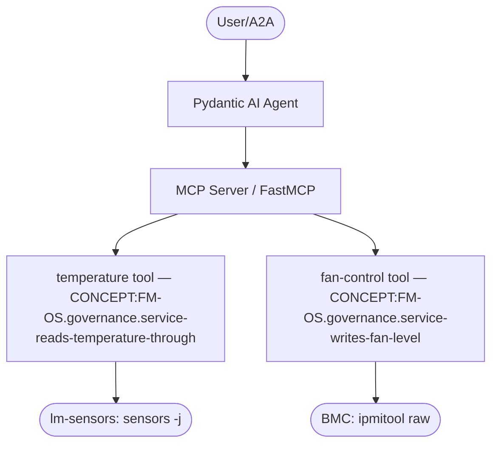

# fan-manager — Concept Overview

> **Category**: Infrastructure | **Ecosystem Role**: MCP Server + A2A Agent
> Built on [`scion-sdk`](https://github.com/Knuckles-Team/scion-sdk) — the unified AGI Harness.

## Description

Dell PowerEdge Fan Manager + MCP Server + A2A Server. Reads CPU/sensor
temperatures via `lm-sensors` and controls fan speed via `ipmitool`.

## Architecture



This project follows the standardized agent-package pattern:

```
fan-manager/
├── fan_manager/
│   ├── __init__.py
│   ├── fan_manager.py        # Core logic (CLI, sensors, IPMI)
│   ├── api_client.py         # Local-command facade (Api)
│   ├── models.py             # Pydantic input/output models
│   ├── auth.py               # No-op/local auth (no remote creds)
│   ├── mcp_server.py         # MCP entrypoint (create_mcp_server)
│   ├── agent_server.py       # A2A agent entrypoint
│   ├── agent_data/IDENTITY.md
│   └── mcp/                  # Action-routed tool modules
│       ├── mcp_temperature.py
│       └── mcp_fan_control.py
├── tests/
├── docs/
├── pyproject.toml
└── mcp_config.json
```

## Typed Tool Surface

The SDK serves one typed tool per public method of the `Api` facade and the `IpmiApi`
BMC client. Only the telemetry ingest tools are written by hand.

| Tool | Concept |
|------|---------|
| `fan_manager_get_temp`, `fan_manager_get_core_temp` | `CONCEPT:FM-OS.governance.service-reads-temperature-through` |
| `fan_manager_set_fan`, `fan_manager_auto_set_fan_speed` | `CONCEPT:FM-OS.governance.service-writes-fan-level` |
| `fan_manager_ipmi_*` | BMC power, chassis, sensors, event log, network, users and controller |
| `fan_ingest_telemetry_temperature`, `fan_ingest_telemetry_sensors` | Knowledge-graph ingest |

## Enterprise Readiness

All agents in the ecosystem inherit enterprise-grade infrastructure from
`scion-sdk`:

| Feature | Status | Source |
|:--------|:-------|:-------|
| **OpenTelemetry Instrumentation** | ✅ Built-in | `scion-sdk[logfire]` |
| **Audit Logging** | ✅ Built-in | Append-only compliance trail (external `AU-OS.governance.wasm-micro-agent-sandbox`) |
| **Prompt Injection Defense** | ✅ Built-in | Pattern scanner + jailbreak taxonomy (external `OS-5.1`) |
| **Guardrail Engine** | ✅ Built-in | Input/output interception (external `AU-OS.governance.reactive-multi-axis-budget`) |

> 📖 **Full Registry**: See [`scion-sdk/docs/overview.md`](https://github.com/Knuckles-Team/scion-sdk/blob/main/docs/overview.md) for the complete 5-Pillar concept index.
